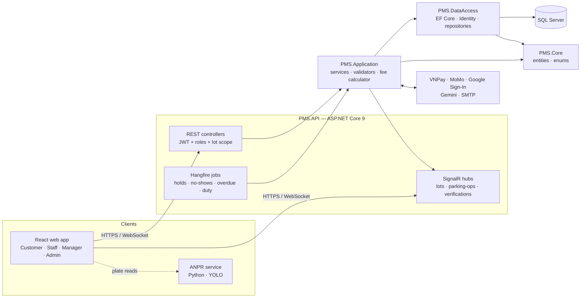

<div align="center">

# 🅿️ XXIV Parking — Backend API

**Multi-lot parking management, from the entry barrier to the end-of-day report.**

Gate operations · bookings with deposits · live 3D lot map · cash & online payments · plate recognition · AI help desk


[Frontend repo](https://github.com/PhatNTSE182807/PMS-FRONTEND) · [API reference](docs/API_DOCUMENTATION.md) · [Requirements (SRS v1.6)](docs/SRS_v1.6.md) · [Demo data](docs/DEMO_DATA.md)

</div>

---

## ✨ What it does

XXIV Parking runs a chain of parking lots. Cars and motorbikes enter and leave through staffed lanes,
customers book bays ahead from a 3D map, every fee is priced by time blocks, and every cent of cash
and online money is tracked until a Manager signs it off.

| Who | What they get |
| --- | --- |
| 🚗 **Customer** (User / Guest) | Live 3D map of free bays · bookings by arrival time with an optional deposit · motorbike "park now" · wallet with VNPay / MoMo top-ups · pay in the app before leaving · vehicle registration & verification · parking history · directions to the lot · AI chat assistant |
| 🧑‍✈️ **Staff** (gate & counter) | Check-in / check-out lanes with camera plate reads · POS with cash drawer · lost tickets with ID papers · exceptions & alerts · vehicle verification queue · duty board |
| 🧑‍💼 **Manager** (per lot) | Lot console · pricing rules, drafts and history · reservations & booked-bay cases · approval queue (Maker-Checker) · Staff accounts · weekly work schedules · lot revenue |
| 🛡️ **Admin** (chain-wide) | Lots, zones and slots · Manager & customer accounts · revenue reports · live capacity · payroll · parking simulation for demos |

### Highlights

- **Two kinds of bays** — signposted *reservation slots* with a strict state machine, and *walk-in capacity* tracked by a zone counter.
- **Fair pricing engine** — block pricing, day/night rates, daily caps, exit window and late-exit fee, deposit offset at check-out, all configurable per lot and vehicle type.
- **Real-time everywhere** — SignalR hubs push slot status, gate queues, cash requests and notifications to every open screen; no polling.
- **Money you can audit** — financial records are immutable, corrections are new adjustment rows, and nobody approves their own request.
- **Privacy by design** — public endpoints never expose licence plates; registration photos are permission-gated and every read is audited.
- **Signed tickets** — QR tickets, booking codes and exit passes are HMAC-signed.
- **Plate recognition** — a two-stage YOLO reader for Vietnamese plates, trained on images rendered from the 3D gate lanes ([`tools/anpr`](tools/anpr/README.md)).
- **AI help desk** — retrieval-augmented chat on Google Gemini over the lot's own help files and live prices, with an offline fallback.
- **Demo-ready** — one switch seeds a full story of accounts and activity; the Admin simulation runs a whole lot in seconds.

---

## 🏗️ Architecture



| Project | Role |
| --- | --- |
| `src/PMS.API` | Controllers, SignalR hubs, middleware (errors, transactions, timing), Swagger, Hangfire dashboard, help files for the assistant |
| `src/PMS.Application` | Business services, FluentValidation rules, Mapster profiles, payment gateways, assistant, background jobs, demo seed |
| `src/PMS.DataAccess` | `DbContext`, migrations, ASP.NET Identity, repositories and unit of work |
| `src/PMS.Core` | Entities, enums and domain exceptions — no dependencies |
| `src/PMS.Shared` | Cross-cutting helpers |
| `tests/` | xUnit unit tests, `WebApplicationFactory` integration tests, assistant evaluation |
| `tools/anpr` | Plate reader: dataset, training, evaluation and HTTP service |

---

## 🧰 Tech stack

| Area | Choice |
| --- | --- |
| Runtime | .NET 9, ASP.NET Core Web API |
| Data | Entity Framework Core 9 · SQL Server (LocalDB in development, Azure SQL in the cloud) · in-memory provider for tests |
| Identity | ASP.NET Core Identity · JWT bearer · Google Sign-In · password reset by email (MailKit) |
| Real-time | SignalR |
| Background work | Hangfire (SQL Server storage, in-memory in tests) |
| Validation & mapping | FluentValidation · Mapster |
| Payments | VNPay · MoMo · internal wallet |
| AI | Google Gemini (embeddings + chat) through the OpenAI-compatible API |
| Plate recognition | Python · Ultralytics YOLO · FastAPI |
| Docs & ops | Swagger · Docker · GitLab CI / GitHub Actions · Azure App Service |

---

## 🚀 Quick start

**Requirements:** .NET 9 SDK, SQL Server or LocalDB (Windows), optionally Docker.

```bash
git clone https://github.com/PhatNTSE182807/PMS-BACKEND.git
cd PMS-BACKEND
dotnet run --project src/PMS.API
```

On start the API applies migrations, creates the database and — in Development — seeds the demo accounts and
activity described in [docs/DEMO_DATA.md](docs/DEMO_DATA.md).

| URL | What |
| --- | --- |
| `https://localhost:5001/swagger` | Interactive API reference |
| `https://localhost:5001/hangfire` | Background jobs dashboard |
| `/api/hubs/lots` · `/api/hubs/parking-ops` · `/api/hubs/vehicle-verifications` | SignalR hubs |

**With Docker** (API + SQL Server 2022):

```bash
docker compose up --build      # API on http://localhost:8080
```

### Configuration

Settings live in `src/PMS.API/appsettings*.json`; override them with environment variables
(`Section__Key`) or user secrets. Never commit real keys.

| Key | Purpose |
| --- | --- |
| `Database:ConnectionString` | SQL Server connection |
| `Seed:DemoData` | Seed demo accounts and activity (`true` in Development) |
| `GoogleAuth:ClientId` | Google Sign-In (must match the frontend) |
| `Assistant:ApiKey` | Gemini key for the chat assistant (empty = offline answers) |
| `Parking:*` | Holds, deposit, exit window, wallet limits, ANPR threshold… |
| VNPay / MoMo sections | Payment gateway credentials and return URLs |

---

## 🧪 Tests

```bash
dotnet build PMS.sln
dotnet test tests/PMS.Application.UnitTests
dotnet test tests/PMS.Api.IntegrationTests
```

Integration tests run on an in-memory database, so no SQL Server is needed. Coverage and the HTML
report: [tests/README.md](tests/README.md).

---

## 🔄 CI/CD

| Stage | When | What |
| --- | --- | --- |
| build | every push / merge request | restore + Release build |
| test | every push / merge request | unit + integration tests, JUnit and Cobertura reports |
| docker | `develop`, `main`, tags | build the API image |
| deploy | push to `production` | publish and zip-deploy to Azure App Service, then wait for `/swagger` |

Details: [docs/CI-CD.md](docs/CI-CD.md) (GitLab) · [docs/GITHUB-ACTIONS.md](docs/GITHUB-ACTIONS.md) (GitHub mirror).

---

## 📚 Documentation

| Document | Content |
| --- | --- |
| [SRS v1.6](docs/SRS_v1.6.md) | Full requirements, business rules and use cases — the source of truth |
| [API_DOCUMENTATION.md](docs/API_DOCUMENTATION.md) | Endpoints and contracts |
| [DEMO_DATA.md](docs/DEMO_DATA.md) | Demo accounts and the seeded parking story |
| [WORK_SCHEDULING.md](docs/WORK_SCHEDULING.md) · [PAYROLL.md](docs/PAYROLL.md) | Duty board, leave and pay |
| [LOT_PERFORMANCE_API.md](docs/LOT_PERFORMANCE_API.md) | Revenue and lot performance reports |
| [tools/anpr](tools/anpr/README.md) | Training and running the plate reader |

---

## 🤝 Contributing

- Branch from `develop` as `features/<feature-name>`; use the same name in the frontend repo when a feature touches both.
- Conventional Commits in English (`feat(gate): …`, `fix(payments): …`).
- Build and test pass → merge into `develop`. Releases go `develop` → `main` → `production`.

<div align="center">

Built by **Team 03 · HCM26 CPL .NET 07** — FPT Software Academy OJT

</div>
